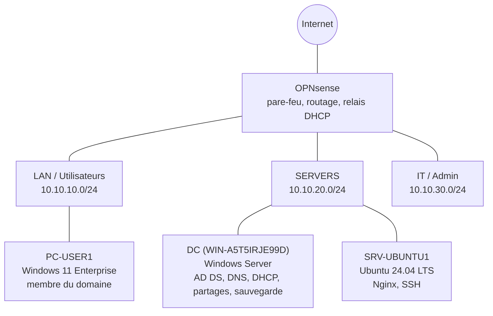

# Lab d'administration systèmes — Infrastructure Windows / Linux d'entreprise

Conception, administration et dépannage d'une petite infrastructure d'entreprise : **Active Directory, DNS, DHCP, GPO, partages NTFS, serveur Linux durci, mises à jour, sauvegarde et restauration**, avec un journal de tous les incidents rencontrés.

> Projet réalisé dans un lab VirtualBox. Toutes les adresses sont privées, aucun mot de passe ni secret n'est publié.

---

## Contexte

Ingénieur en cybersécurité, je construis un parcours de labs pour couvrir l'ensemble de l'infrastructure : **réseau → systèmes → cloud → IAM → GRC**.

Le premier projet a mis en place un réseau segmenté derrière un pare-feu OPNsense. Ce deuxième projet s'appuie sur ce réseau pour pratiquer l'**administration systèmes** au quotidien : déployer, configurer, sécuriser, diagnostiquer et documenter. L'annuaire Active Directory construit ici servira de socle au futur projet IAM.

## Objectifs

- Administrer un serveur Linux : comptes, permissions, services, logs, mises à jour, SSH, pare-feu local.
- Structurer un domaine Active Directory selon les bonnes pratiques (OU, groupes, méthode AGDLP).
- Automatiser la création de comptes avec PowerShell.
- Distribuer les adresses par DHCP Windows à travers un relais, joindre un poste au domaine.
- Appliquer des GPO de sécurité et de confort.
- Mettre en place des partages avec des permissions NTFS au moindre privilège.
- Sauvegarder **et tester la restauration**.
- Diagnostiquer des incidents avec une méthode reproductible, et les documenter.

## Architecture



| Machine | Rôle | Adresse |
|---|---|---|
| OPNsense | Pare-feu, routage inter-réseaux, relais DHCP | 10.10.10.1 / 10.10.20.1 / 10.10.30.1 |
| DC | Contrôleur du domaine `company.local`, DNS, DHCP, partage de fichiers, Windows Server Backup | 10.10.20.20 |
| SRV-UBUNTU1 | Serveur web Nginx, administration SSH | 10.10.20.10 |
| PC-USER1 | Poste utilisateur Windows 11 Enterprise, joint au domaine | DHCP (10.10.10.100-200) |

Détails : [architecture/](architecture/README.md)

## Technologies

| Domaine | Outils |
|---|---|
| Virtualisation | VirtualBox |
| Réseau | OPNsense (pare-feu, DHCRelay), ufw |
| Windows | Windows Server (AD DS, DNS, DHCP, File Server, Windows Server Backup), Windows 11 Enterprise |
| Linux | Ubuntu Server 24.04 LTS, systemd, journald, apt / unattended-upgrades, OpenSSH, Nginx |
| Automatisation | PowerShell (module ActiveDirectory, GroupPolicy, DhcpServer, SmbShare), Bash |
| Diagnostic | `dig`, `resolvectl`, `nslookup`, `Test-NetConnection`, `journalctl`, `gpresult`, `klist`, `wbadmin`, NetSetup.log, Observateur d'événements |

## Ce qui a été mis en place

### Linux — [linux/](linux/)
- Utilisateurs et groupes métier, dossier collaboratif avec **setgid**, délégation **sudo** limitée à une seule commande.
- Services **systemd** : séparation des privilèges de Nginx, relance automatique par surcharge (*drop-in*), lecture et tri des logs.
- **Patch management** : diagnostic de mises à jour automatiques silencieusement bloquées, fenêtre de maintenance complète (snapshot, mise à jour, redémarrage noyau, vérifications).
- **SSH par clé uniquement**, root interdit, liste d'utilisateurs autorisés ; **pare-feu ufw** en refus par défaut ; masquage de la version Nginx ; désactivation de services inutiles.

### Windows / Active Directory — [windows/](windows/)
- Arborescence d'**OU** dédiée, groupes globaux et de domaine local selon **AGDLP**.
- **Script PowerShell idempotent** de création d'utilisateurs depuis un CSV, sans mot de passe en clair.
- **DHCP Windows** autorisé dans l'AD, **relais DHCP** sur OPNsense, jonction du poste au domaine, redirection des nouveaux ordinateurs vers leur OU.
- **GPO** : politique de mots de passe et de verrouillage, restrictions utilisateur, verrouillage d'écran, bannière légale, lecteur réseau ciblé par groupe.
- **Partage** avec permissions NTFS au moindre privilège et **énumération basée sur l'accès** (ABE).
- **Corbeille AD**, **sauvegarde** de l'état du système et du partage, **test de restauration** chronométré.

## Sécurité

| Mesure | Où |
|---|---|
| Moindre privilège : sudo limité, comptes de service sans shell, workers Nginx non privilégiés | Linux |
| SSH : clé ed25519 avec phrase de passe, pas de mot de passe, pas de root, `AllowUsers`, `MaxAuthTries 3` | Linux |
| Pare-feu local : refus par défaut, SSH restreint aux réseaux d'administration | Linux |
| Correctifs de sécurité appliqués et automatisation vérifiée | Linux |
| Réduction de surface : services inutiles désactivés, version Nginx masquée | Linux |
| AGDLP : aucune permission donnée directement à un utilisateur | AD |
| Mots de passe : 12 caractères minimum, verrouillage après 5 échecs | GPO |
| Mot de passe initial jamais stocké, changement forcé à la première connexion | Script |
| Verrouillage de session après 10 min, bannière légale | GPO |
| Héritage NTFS coupé, « Modifier » au lieu de « Contrôle total », ABE | Partages |
| DHCP autorisé dans l'AD (protection contre les DHCP non autorisés) | DHCP |
| Corbeille AD, sauvegarde de l'état du système, restauration testée | Sauvegarde |

## Incidents et troubleshooting — [troubleshooting/](troubleshooting/README.md)

Chaque incident est documenté : symptôme, diagnostic, cause racine, correction, vérification, leçons.

| # | Incident | Cause racine | Type |
|---|---|---|---|
| 01 | `apt` en échec et horloge fausse | Serveur interrogeant un DNS muet, DC sans redirecteur, horloge des VM restaurées | Réel |
| 02 | Site hors ligne après l'arrêt brutal de Nginx | Aucune relance automatique par défaut | Provoqué |
| 03 | 56 correctifs de sécurité jamais installés | Condition « sur secteur » : la VM voyait la batterie du PC hôte | Réel |
| 04 | Perte de l'accès SSH | Configuration corrompue + redémarrage malgré l'échec du test | Réel |
| 05 | Jonction au domaine refusée | Windows 11 **Home** (ne peut pas rejoindre un domaine) | Réel |
| 06 | Compte utilisateur verrouillé | Politique de verrouillage + mot de passe erroné | Réel |
| 07 | Site hors ligne, disque plein | Log non tourné, alimenté par un script en boucle | Simulé |
| 08 | Utilisateur privé d'accès au partage | Retiré du groupe global | Simulé |
| 09 | Relation d'approbation rompue | Snapshot ancien → mot de passe du compte ordinateur désynchronisé | Simulé |

*Réel : survenu pendant le projet. Provoqué : déclenché volontairement pour tester. Simulé : exercice de diagnostic sur table, non reproduit dans le lab.*

Méthode utilisée : [docs/methode-troubleshooting.md](docs/methode-troubleshooting.md)

## Automatisation

- [`scripts/powershell/New-Users.ps1`](scripts/powershell/New-Users.ps1) : création d'utilisateurs AD depuis un CSV (idempotent, gestion d'erreurs, mot de passe demandé à l'exécution, splatting).
- Création des OU, groupes, GPO, étendue DHCP et partage entièrement en PowerShell.
- Fichiers de configuration Linux versionnés dans [`configs/`](configs/).

## Résultats

- Un utilisateur du domaine se connecte sur le poste, reçoit son lecteur réseau, accède à son dossier métier et **ne voit pas** celui des autres services.
- Le jeton de l'utilisateur contient ses groupes globaux **et** de domaine local ; l'authentification se fait en Kerberos AES-256.
- Le serveur Linux n'accepte que les connexions SSH par clé, depuis les réseaux autorisés.
- Un utilisateur supprimé par erreur est restauré à l'identique (même SID) en quelques secondes ; un fichier supprimé est restauré en environ **5 minutes**.

## Compétences acquises

- **Linux** : permissions et bits spéciaux, sudoers, systemd (unités, surcharges, timers, signaux), journald et logrotate, apt et unattended-upgrades, netplan, systemd-resolved, OpenSSH, ufw.
- **Windows Server / AD** : OU, groupes et étendues, AGDLP, comptes ordinateurs, Kerberos (TGT, tickets de service), DNS AD (SRV, redirecteurs, enregistrements), service de temps, DHCP et relais, GPO et préférences, NTFS et SMB, corbeille AD, Windows Server Backup.
- **Automatisation** : PowerShell (pipeline objet, splatting, gestion d'erreurs, idempotence).
- **Troubleshooting** : approche par couches, comparaison, lecture des journaux (journald, NetSetup.log, Observateur d'événements), distinction entre symptôme et cause racine.
- **Pratiques professionnelles** : tester avant de redémarrer un service, garder un accès de secours, ne jamais modifier les fichiers des paquets, vérifier avant toute action destructrice, documenter.

## Limites et améliorations

| Limite assumée | En entreprise |
|---|---|
| Partage hébergé sur le DC | Serveur de fichiers membre dédié, avec quotas |
| Un seul DC | Au moins deux DC (redondance, réplication) |
| Sauvegarde sur un disque de la même VM (3-2-1 non respecté) | Serveur de sauvegarde séparé, copie hors site et immuable, sauvegardes planifiées |
| Administration depuis le DC | Poste d'administration dédié dans le réseau IT |
| Même mot de passe initial pour tous | Mot de passe aléatoire et unique par utilisateur |
| Domaine en `.local` | Sous-domaine d'un nom public possédé (ex. `ad.entreprise.fr`) |
| Pas de supervision | Alertes disque, services, redémarrages, correctifs en attente |
| Pas de LAPS ni de comptes d'administration séparés | Traités dans le projet IAM |

## Structure du dépôt

```
├── README.md
├── architecture/          plan d'adressage, machines, flux
├── linux/                 comptes et permissions, services et logs, mises à jour, SSH et pare-feu
├── windows/               AD, DHCP et jonction, GPO, partages, sauvegarde
├── scripts/powershell/    script de création d'utilisateurs + CSV d'exemple
├── configs/               fichiers de configuration Linux (SSH, systemd, apt, nginx)
├── troubleshooting/       un fichier par incident
└── docs/                  méthode de troubleshooting, aide-mémoire des commandes
```
